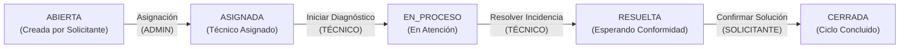
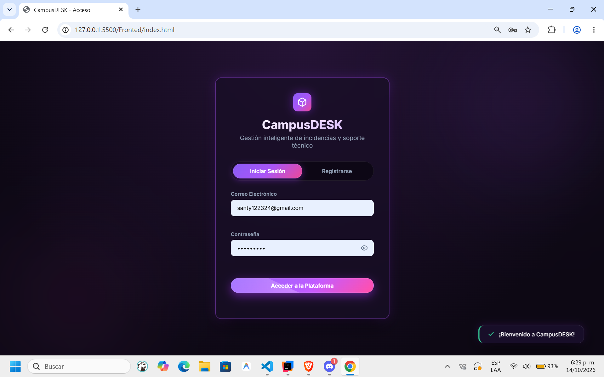
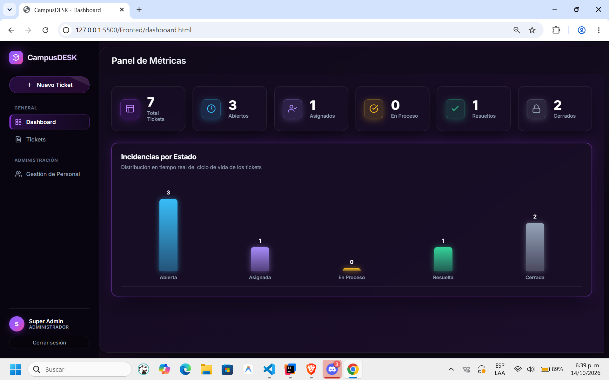
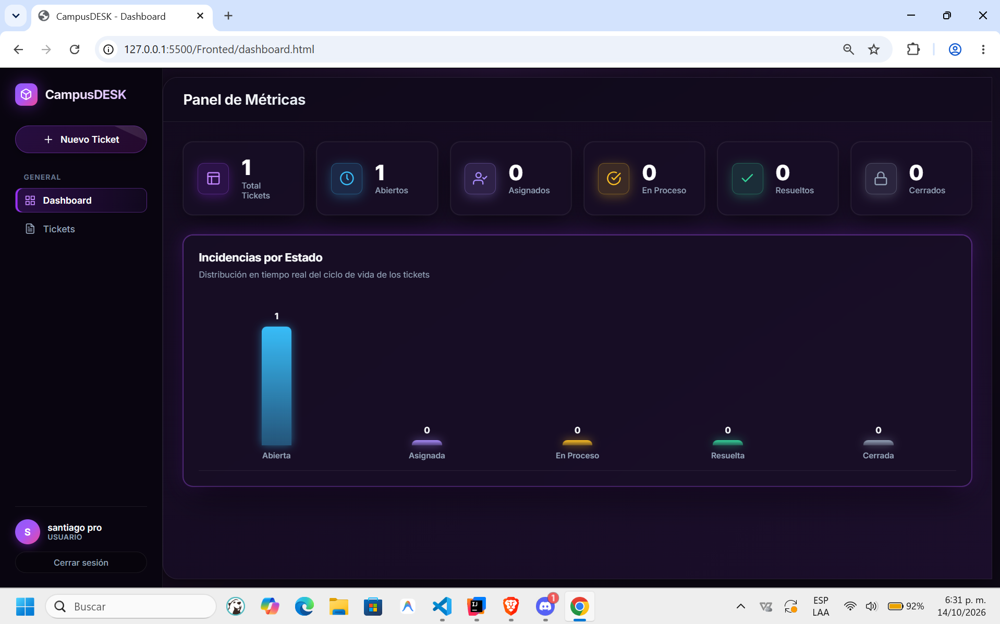
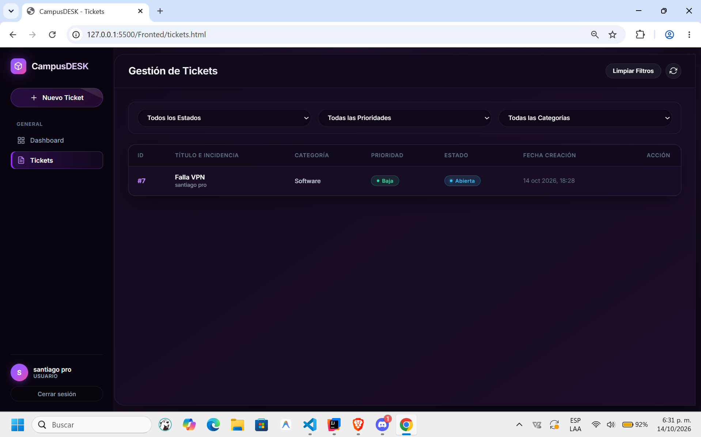
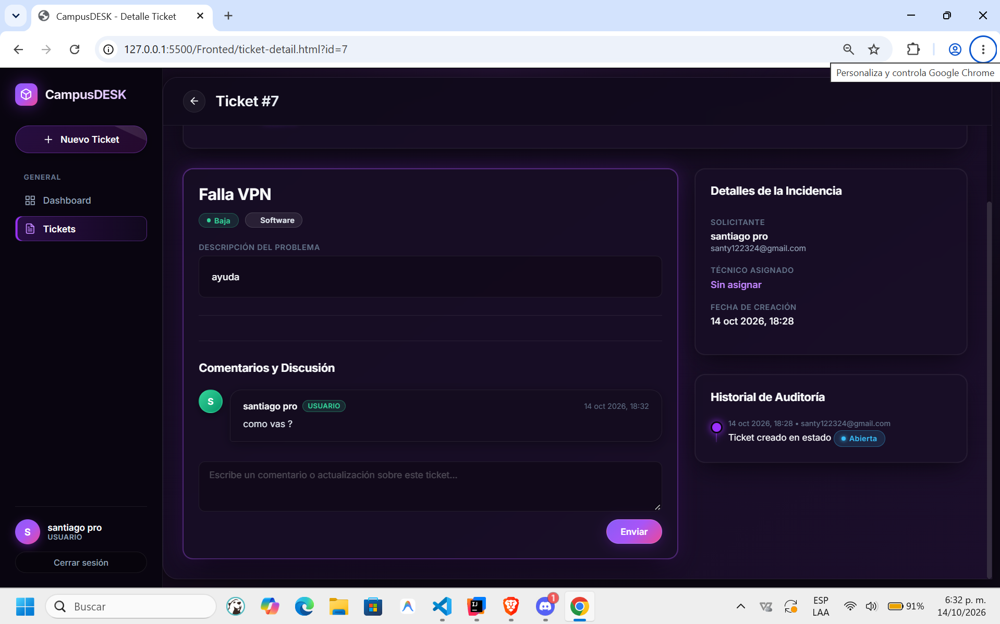
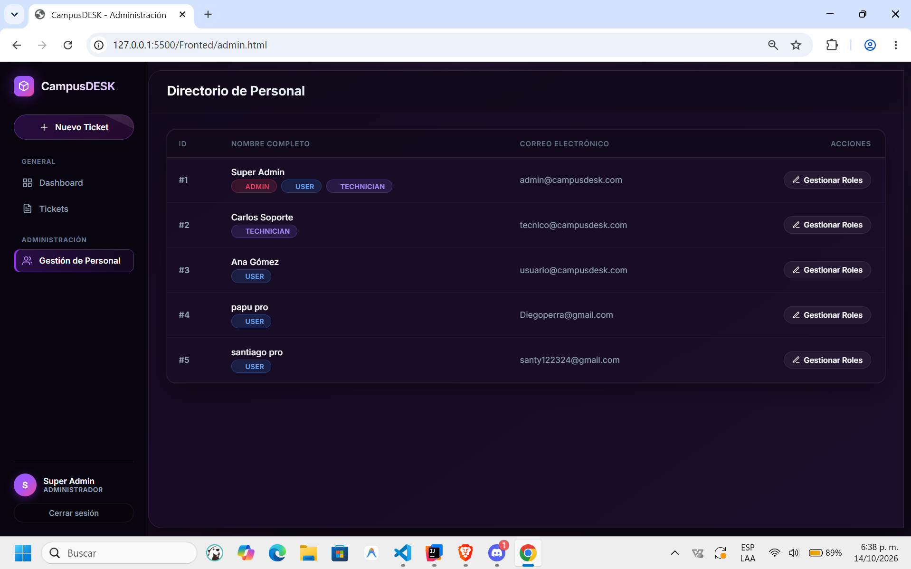
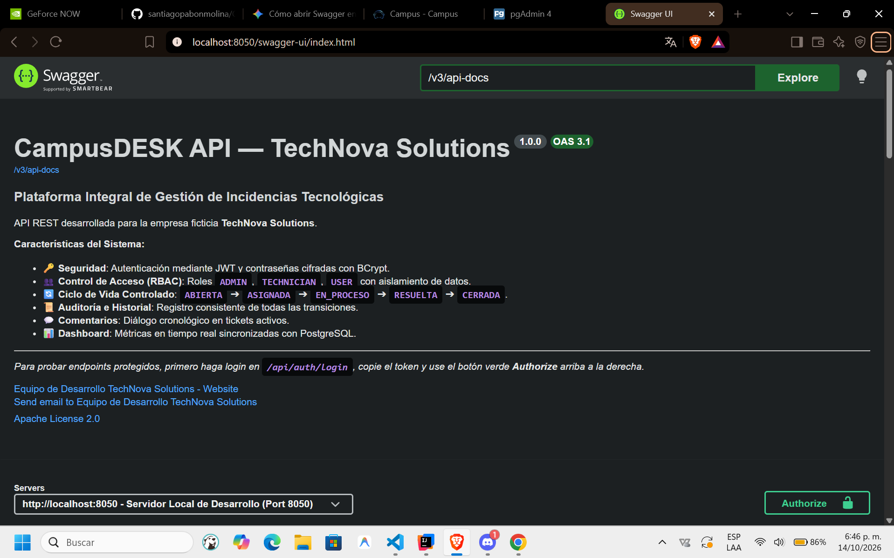
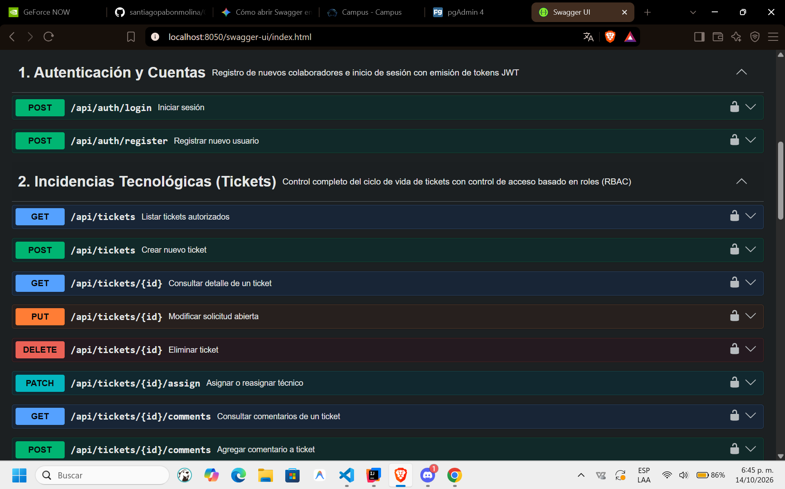
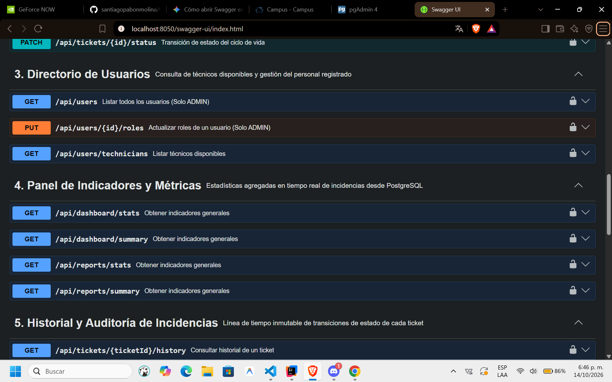

# 🏢 CampusDESK — Plataforma de Gestión de Incidencias Tecnológicas

> **TechNova Solutions**  
> Solución corporativa integral para la centralización, reporte, asignación, seguimiento, resolución y auditoría de incidencias técnicas en infraestructura y servicios de TI.

---

## 👥 Integrantes del Equipo

* **Santiago Pabón Molina**
* **Diego Andrés Parra**
* **Carlos Andrés Lindarte**

---

## 📌 Descripción del Proyecto

**CampusDESK** es una solución web empresarial desarrollada para **TechNova Solutions** (organización con más de 200 colaboradores). La plataforma sustituye los canales informales y fragmentados (como correos electrónicos y chats de mensajería) por un sistema centralizado, auditable y con aislamiento estricto de datos mediante control de acceso basado en roles (**RBAC**).

### Características Principales:
* **Trazabilidad Inmutable:** Registro histórico de auditoría por cada evento (creación, cambio de estado, asignación de técnicos y comentarios).
* **Control de Acceso Basado en Roles (RBAC):** Privilegios delimitados entre `ADMIN`, `TECHNICIAN` y `USER`.
* **Máquina de Estados Obligatoria:** Validación estricta del ciclo de vida del ticket (`ABIERTA` ➔ `ASIGNADA` ➔ `EN_PROCESO` ➔ `RESUELTA` ➔ `CERRADA`).
* **Seguridad sin Estado (Stateless):** Autenticación y autorización mediante tokens JWT (HMAC-SHA256) con contraseñas cifradas en BCrypt.
* **Dashboard Analítico en Tiempo Real:** Métricas agregadas y conteos en vivo sincronizados con PostgreSQL.
* **Cliente Ligero Desacoplado:** Frontend construido en JavaScript nativo modular (ES6+), sin sobrecarga de frameworks ni librerías externas.

---

## 🛠️ Tecnologías Utilizadas

### Backend
* **Lenguaje:** Java 21 (LTS)
* **Framework:** Spring Boot 4.1.1 / Spring Framework 6
* **Persistencia:** Spring Data JPA / Hibernate ORM
* **Seguridad:** Spring Security con filtros personalizados para JWT y BCrypt Password Encoder
* **Validación de Datos:** Jakarta Bean Validation / Hibernate Validator
* **Documentación Interactiva:** Springdoc OpenAPI 3.1.0 (Swagger UI con integración BearerAuth)
* **Gestor de Dependencias y Construcción:** Gradle 9.7 con Gradle Wrapper

### Base de Datos
* **Motor:** PostgreSQL 17
* **Administrador Web:** pgAdmin 4 (orquestado vía Docker)
* **Persistencia y Scripts:** Docker Volumes con carga automatizada de scripts DDL y DML

### Frontend
* **Arquitectura:** Single/Multi-page desacoplada en **Vanilla JavaScript (ES6+ Modules)**
* **Diseño y Estilos:** HTML5 semántico y CSS3 puro con Custom Properties (Variables CSS), Grid, Flexbox y Glassmorphism
* **Consumo de API:** Fetch API nativa y sintaxis asíncrona (`async/await`)
* *(Sin dependencias de frameworks como React, Angular, Vue, Bootstrap o Tailwind)*

---

## 📋 Requisitos Previos

Antes de ejecutar el proyecto, asegúrate de contar con las siguientes herramientas instaladas en tu sistema:

1. **Java Development Kit (JDK):** Versión 21 o superior ([Descargar JDK 21](https://www.oracle.com/java/technologies/downloads/#java21)).
   ```bash
   java -version
   ```
2. **Docker y Docker Compose:** Para levantar PostgreSQL y pgAdmin ([Docker Desktop](https://www.docker.com/products/docker-desktop/)).
   ```bash
   docker compose version
   ```
3. **Servidor HTTP Local para el Frontend:** Python 3 (`python -m http.server`), Node.js (`npx serve`) o la extensión **Live Server** de VS Code.
4. **Git:** Para el control de versiones.

---

## 📥 Instrucciones de Instalación

1. **Clonar el repositorio:**
   ```bash
   git clone https://github.com/tu-usuario/CampusDESK.git
   cd CampusDESK
   ```

2. **Preparar las variables de entorno:**
   Copia el archivo de plantilla `.env.example` y renómbralo a `.env`:
   ```powershell
   # En Windows (PowerShell)
   Copy-Item .env.example .env

   # En Linux / macOS
   cp .env.example .env
   ```

3. **Verificar dependencias del proyecto:**
   ```bash
   # En Windows
   .\gradlew.bat --version

   # En Linux / macOS
   ./gradlew --version
   ```

---

## ⚙️ Configuración Mediante Variables de Entorno

El sistema permite parametrizar credenciales y puertos mediante el archivo `.env` o variables del sistema:

| Variable | Descripción | Valor por Defecto / Recomendado |
| :--- | :--- | :--- |
| `DB_URL` | URL de conexión JDBC hacia PostgreSQL | `jdbc:postgresql://localhost:5438/campusDESK` |
| `DB_USERNAME` | Usuario de base de datos | `dev_user` |
| `DB_PASSWORD` | Contraseña del usuario de base de datos | `DevTeamSecurePass2026!` |
| `JWT_SECRET` | Clave secreta para firmar tokens JWT (mínimo 256 bits) | `campusDeskSecretKey2026SuperSecureRandomStringAtLeast256BitsLong!!` |
| `JWT_EXPIRATION` | Tiempo de vida del JWT en milisegundos (24 horas) | `86400000` |
| `SERVER_PORT` | Puerto HTTP donde corre la API REST de Spring Boot | `8050` |
| `CORS_ALLOWED_ORIGINS` | Orígenes web autorizados para interactuar con la API | `http://127.0.0.1:5500,http://localhost:5500,http://127.0.0.1:5501,http://localhost:5501` |

---

## 🗄️ Instrucciones para Preparar PostgreSQL

El proyecto contiene un entorno de base de datos containerizado y preconfigurado con Docker Compose:

### 1. Iniciar los Contenedores (Recomendado)

En la raíz del proyecto, ejecuta:

```bash
docker compose up -d
```

Esto desplegará los siguientes servicios:
* **`dev_postgres` (PostgreSQL 17):**
  * **Host:** `localhost`
  * **Puerto expuesto:** `5438` (mapeado a `5432` interno)
  * **Base de datos:** `campusDESK`
  * **Usuario:** `dev_user`
  * **Contraseña:** `DevTeamSecurePass2026!`
  * **Scripts de inicialización automática (`/docker-entrypoint-initdb.d`):**
    * `01-schema.sql`: Estructura relacional completa (tablas `users`, `role`, `user_roles`, `tickets`, `comments`, `ticket_history`, foreign keys e índices).
    * `02-seed-data.sql`: Carga oficial de roles y cuentas maestras con contraseñas hasheadas en BCrypt.
    * `03-sample-tickets.sql`: Carga de incidencias de demostración en diferentes estados con histórico y comentarios.
* **`dev_pgadmin` (pgAdmin 4):**
  * **URL de acceso:** [http://localhost:5055](http://localhost:5055)
  * **Email:** `team@devlocal.com`
  * **Contraseña:** `PgAdminTeamPass2026!`

### 2. Recarga o Ejecución Manual con `psql` (Opcional)

Si requieres reiniciar o correr los scripts manualmente en el contenedor:

```bash
# 1. Esquema DDL
docker exec -i dev_postgres psql -U dev_user -d campusDESK < scripts/01-schema.sql

# 2. Datos maestros y usuarios
docker exec -i dev_postgres psql -U dev_user -d campusDESK < scripts/02-seed-data.sql

# 3. Tickets de muestra
docker exec -i dev_postgres psql -U dev_user -d campusDESK < scripts/03-sample-tickets.sql
```

---

## 🔐 Descripción de Roles y Cuentas Preconfiguradas

El sistema aplica control de acceso basado en roles (**RBAC**):

### 1. Rol `ADMIN` (Super Administrador)
* **Alcance:** Control total de la plataforma. Visualiza todos los tickets corporativos, asigna y reasigna personal técnico responsable, gestiona el directorio de colaboradores y audita métricas consolidadas.
* **Credenciales del Super Administrador:**
  * **Correo Electrónico:** `admin@campusdesk.com`
  * **Contraseña:** `SuperAdmin2026!`
  * **Roles asignados:** `ROLE_ADMIN`, `ROLE_TECHNICIAN`, `ROLE_USER` (Acceso irrestricto)

### 2. Rol `TECHNICIAN` (Técnico de Soporte)
* **Alcance:** Acceso delimitado **exclusivamente** a los tickets que le han sido asignados. Administra las fases de atención (`ASIGNADA` ➔ `EN_PROCESO` ➔ `RESUELTA`) y registra comentarios de soporte.
* **Credenciales de prueba:**
  * **Correo Electrónico:** `tecnico@campusdesk.com`
  * **Contraseña:** `Tech2026!`
  * **Rol asignado:** `ROLE_TECHNICIAN`

### 3. Rol `USER` (Usuario Solicitante)
* **Alcance:** Creación de solicitudes. Puede consultar y editar **únicamente** sus propios tickets mientras se encuentren en estado `ABIERTA` y sin técnico asignado. Es el único que puede validar y confirmar el cierre definitivo (`CERRADA`) una vez que el ticket esté en estado `RESUELTA`.
* **Credenciales de prueba:**
  * **Correo Electrónico:** `usuario@campusdesk.com`
  * **Contraseña:** `User2026!`
  * **Rol asignado:** `ROLE_USER`

> [!NOTE]
> Todo registro público realizado a través del endpoint `/api/auth/register` o el formulario del frontend recibe de forma obligatoria y predeterminada el rol `USER`.

---

## 🔄 Flujo del Ciclo de Vida de los Tickets



---

## 🚀 Procedimiento de Ejecución del Backend y Frontend

### Paso 1: Iniciar la Base de Datos
Verifica que PostgreSQL esté arriba mediante Docker:
```bash
docker compose up -d
```

### Paso 2: Iniciar el Backend (Spring Boot)
En la raíz del proyecto, ejecuta:

* **En Windows (PowerShell / CMD):**
  ```powershell
  .\gradlew.bat bootRun
  ```
* **En Linux / macOS:**
  ```bash
  ./gradlew bootRun
  ```

El servidor iniciará en el puerto **`8050`** (`http://localhost:8050`).

### Paso 3: Iniciar el Frontend (Vanilla JS Modular)
Dado que el frontend utiliza módulos nativos de ECMAScript (`import`/`export`), debe ejecutarse bajo un servidor HTTP local para permitir CORS e importaciones relativas:

* **Opción A (Recomendada con Python):**
  ```bash
  cd Fronted
  python -m http.server 5500
  ```
  Abre en tu navegador: [http://127.0.0.1:5500/index.html](http://127.0.0.1:5500/index.html)

* **Opción B (Con VS Code Live Server):**
  Abre el directorio `Fronted/` en Visual Studio Code, haz clic derecho sobre `index.html` y pulsa **"Open with Live Server"** (puerto `5500` o `5501`).

* **Opción C (Con Node.js):**
  ```bash
  npx serve Fronted -p 5500
  ```

---

## 📖 Enlace Local para Consultar Swagger / OpenAPI

La API REST cuenta con documentación interactiva con soporte completo para pruebas protegidas por JWT:

* **Swagger UI:** [http://localhost:8050/swagger-ui/index.html](http://localhost:8050/swagger-ui/index.html)
* **Especificación OpenAPI (JSON):** [http://localhost:8050/v3/api-docs](http://localhost:8050/v3/api-docs)

### ¿Cómo autenticarse en Swagger UI?
1. Ingresa a [http://localhost:8050/swagger-ui/index.html](http://localhost:8050/swagger-ui/index.html).
2. Despliega la sección **`1. Autenticación y Cuentas`** y abre el endpoint `POST /api/auth/login`.
3. Haz clic en **Try it out** e inicia sesión con las credenciales del Super Administrador:
   ```json
   {
     "email": "admin@campusdesk.com",
     "password": "SuperAdmin2026!"
   }
   ```
4. Copia el token JWT resultante (sin comillas).
5. Pulsa el botón verde **Authorize 🔓** en la parte superior derecha de Swagger.
6. Pega el token en el campo correspondiente y pulsa **Authorize** ➔ **Close**. A partir de este momento todos los endpoints protegidos se consumirán con el header `Authorization: Bearer <token>`.

---

## 📸 Evidencias de Funcionamiento

A continuación se presentan las capturas de pantalla que respaldan el funcionamiento integral de la solución en sus diferentes vistas, roles y documentación de la API:

### 1. Pantalla de Acceso — Inicio de Sesión y Registro
Formulario con validación visual, diseño glassmorphism responsivo y autenticación contra la API REST.



---

### 2. Dashboard General — Métricas del Administrador
Panel de control con métricas en tiempo real: conteo total de incidencias, distribución por estado (`Abiertos`, `Asignados`, `En Proceso`, `Resueltos`, `Cerrados`) y acceso al módulo administrativo.



---

### 3. Dashboard del Usuario Solicitante
Vista personalizada del panel para colaboradores con sus métricas directas y accesos a sus tickets reportados.



---

### 4. Gestión de Tickets y Filtros Combinados
Módulo de tickets con filtrado por estado, prioridad y categoría, además del modal para radicar un nuevo ticket de soporte.



---

### 5. Detalle de Incidencia y Diálogo Cronológico de Comentarios
Visualización detallada del ticket (código, categoría, prioridad, descripción), panel de transiciones de estado e hilo de discusión interactivo entre usuario y técnicos.



---

### 6. Directorio y Gestión de Personal (Solo ADMIN)
Listado administrativo de usuarios y colaboradores con sus respectivos roles en la organización (`ADMIN`, `TECHNICIAN`, `USER`).



---

### 7. Documentación Swagger UI — Cabecera e Información General
Interfaz interactiva de Swagger UI ejecutándose en `http://localhost:8050/swagger-ui/index.html` con especificación OpenAPI 3.1.0 y soporte BearerAuth.



---

### 8. Swagger UI — Módulo de Autenticación y Cuentas
Endpoints documentados para registro público (`POST /api/auth/register`) e inicio de sesión con emisión de JWT (`POST /api/auth/login`).



---

### 9. Swagger UI — Transición de Estados y Directorio
Endpoints para la gestión del ciclo de vida del ticket (`PATCH /api/tickets/{id}/status`), asignación de técnicos y consulta de disponibilidad.



---

## 📄 Licencia

Proyecto desarrollado con fines académicos y corporativos para **TechNova Solutions** bajo licencia Apache 2.0.
